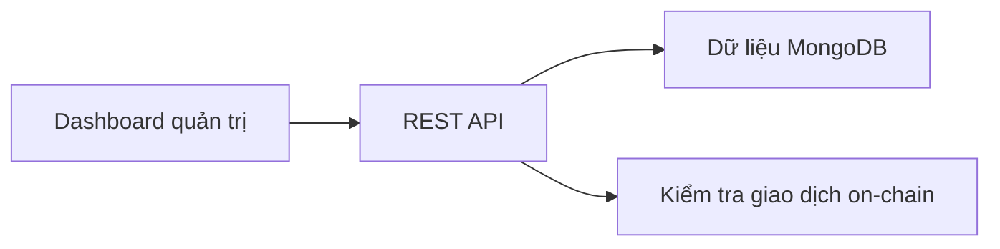

<h1 align="center">Nguyễn Vũ Minh Tuệ</h1>

<strong>Web Development · Backend APIs · Admin Dashboards</strong>

Mình phát triển API và giao diện quản trị cho các ứng dụng mạng xã hội, thương mại điện tử và dự án nhóm.

  
  

## Công nghệ nổi bật

  
  
  
  
  
  

## Mảng mình tập trung

Mình dùng Express để xây dựng API cho tài khoản, bài viết và đơn hàng. Với Next.js và React, mình làm các màn hình quản trị kết nối với API để theo dõi dữ liệu và xử lý yêu cầu xét duyệt.

## Dự án nổi bật

<table>
  <tr>
    <td width="50%" valign="top">
      <h3><a href="https://github.com/tue1501/threads_towns">Threads Towns ↗</a></h3>
      
Backend mạng xã hội. Mình phát triển API cho bài viết, lưu bài, truy vấn người dùng và thông báo.

      
<code>Node.js</code> <code>Express</code> <code>MongoDB</code>

    </td>
    <td width="50%" valign="top">
      <h3><a href="https://github.com/tue1501/node_js_mau">PetLand API ↗</a></h3>
      
Backend thương mại điện tử. Mình xây dựng luồng giỏ hàng, đặt hàng, giảm giá và thống kê doanh thu.

      
<code>Node.js</code> <code>Express</code>

    </td>
  </tr>
  <tr>
    <td width="50%" valign="top">
      <h3>Charity Ledger</h3>
      
Trong dự án nhóm, mình làm dashboard quản trị, API duyệt chiến dịch, KYC và kiểm tra giao dịch rút tiền on-chain.

      
<code>Next.js</code> <code>React</code> <code>TypeScript</code> <code>viem</code>

    </td>
    <td width="50%" valign="top">
      <h3><a href="https://github.com/Thanh123st/iot-mach-nhom">Phòng thông minh ESP32 ↗</a></h3>
      
Trong dự án nhóm, mình bổ sung tài nguyên cho dashboard web, làm bản trình bày trên trình duyệt và sơ đồ khối hệ thống.

      
<code>HTML</code> <code>ESP32</code>

    </td>
  </tr>
</table>

## Hoạt động GitHub

[Xem biểu đồ đóng góp và lịch sử hoạt động](https://github.com/tue1501#js-contribution-activity)
