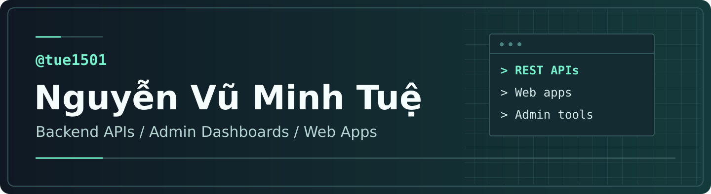

  

  <a href="https://github.com/tue1501?tab=repositories"><strong>Repositories</strong></a>
  &nbsp; · &nbsp;
  <a href="#dự-án-nổi-bật"><strong>Dự án nổi bật</strong></a>
  &nbsp; · &nbsp;
  <a href="#kỹ-năng-qua-dự-án"><strong>Kỹ năng</strong></a>

Mình là **Nguyễn Vũ Minh Tuệ**, tập trung phát triển backend cho ứng dụng web. Mình đã xây dựng API cho mạng xã hội và thương mại điện tử, đồng thời triển khai giao diện và API quản trị cho dự án nhóm.

## Dự án nổi bật

| Dự án | Phần mình thực hiện | Công nghệ |
| --- | --- | --- |
| **[Threads Towns](https://github.com/tue1501/threads_towns)** · Mạng xã hội | Phát triển và chỉnh sửa API cho bài viết, lưu bài, truy vấn người dùng và thông báo. | Node.js, Express, MongoDB |
| **[PetLand API](https://github.com/tue1501/node_js_mau)** · Thương mại điện tử | Xây dựng và hoàn thiện luồng giỏ hàng, đặt hàng, giảm giá, thông báo và thống kê doanh thu. | Node.js, Express |
| **Charity Ledger** · Dự án nhóm | Xây dựng dashboard quản trị và API duyệt chiến dịch, xác minh danh tính (KYC) và xử lý yêu cầu rút tiền. Tích hợp kiểm tra giao dịch on-chain và giao diện tiếng Việt. | Next.js, React, TypeScript, viem |
| **Phòng thông minh** · Dự án nhóm | Bổ sung tài nguyên cho dashboard web, xây dựng bản trình bày trên trình duyệt và sơ đồ khối mô tả hệ thống ESP32. | HTML, ESP32 |

## Kỹ năng qua dự án

- **API và dữ liệu** · Xây dựng REST API với Node.js và Express, tổ chức routes, controllers và models, làm việc với MongoDB qua Mongoose.
- **Luồng nghiệp vụ** · Triển khai giỏ hàng, đặt hàng, mã giảm giá, xác thực OTP và thông báo.
- **Giao diện quản trị** · Xây dựng dashboard với Next.js, React và TypeScript, kết nối giao diện với API và xử lý các bước xét duyệt.
- **Tích hợp hệ thống** · Sử dụng viem để đọc trạng thái và kiểm tra giao dịch on-chain, cập nhật nội dung giao diện đa ngôn ngữ.
